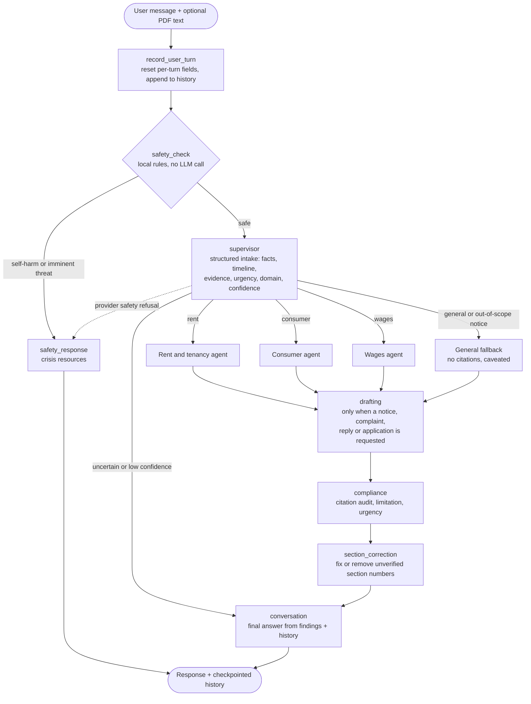
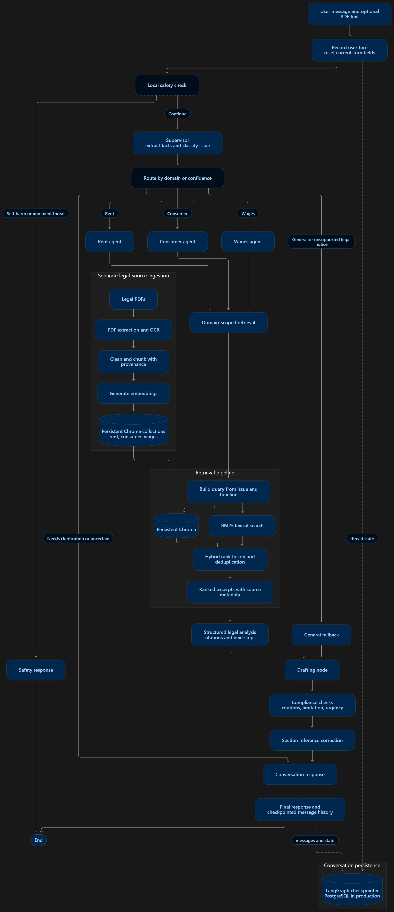
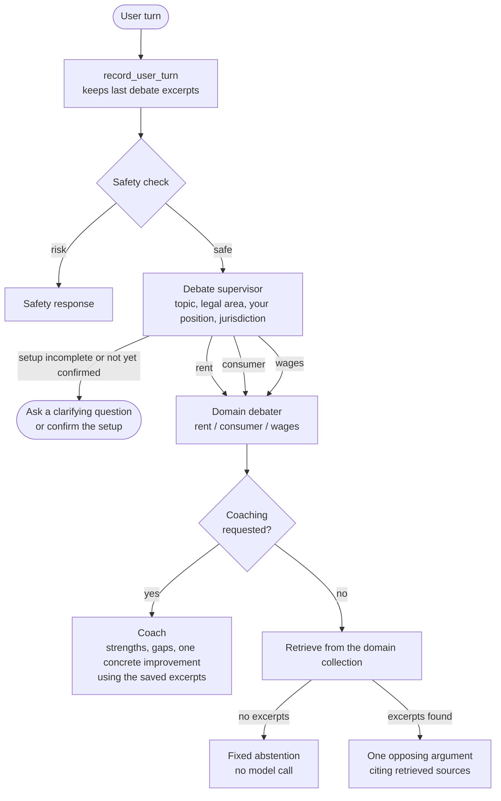
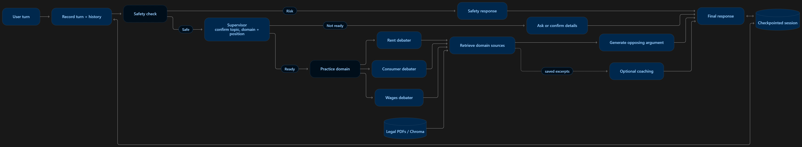
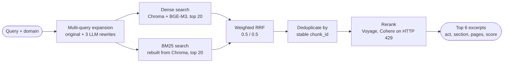
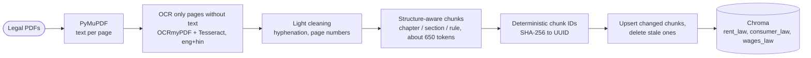

<div align="center">

# ⚖️ LegalMind AI

**Grounded legal help and debate practice for everyday disputes in India**

Two LangGraph agents on a hybrid-RAG backbone: they answer questions and draft documents only from retrieved statute text, check their own citations, and abstain when the law is not in the corpus.

[](https://www.python.org/)
[](https://langchain-ai.github.io/langgraph/)
[](https://python.langchain.com/)
[](https://www.trychroma.com/)
[](https://streamlit.io/)

[](https://codespaces.new/Pavan-220405/LegalMind)

[What it does](#what-it-does) ·
[Architecture](#architecture) ·
[Guardrails](#anti-hallucination-guardrails) ·
[Quickstart](#quickstart) ·
[Configuration](#configuration) ·
[Evaluation](#evaluation) ·
[Limitations](#limitations-and-roadmap)

</div>

<!-- Add a screenshot or short GIF of the app here, e.g.  -->

> [!IMPORTANT]
> LegalMind AI provides **legal information and practice, not legal advice**. It does not replace a qualified lawyer. Always verify deadlines, sections, and remedies for your state and facts before acting.

---

## What it does

Disputes like an unreturned rental deposit, a defective purchase, or unpaid wages are common, but most people don't know where to start. LegalMind AI takes a plain-language description of the problem (and optionally a PDF such as a rent agreement or invoice), works out which area of law applies, retrieves the relevant statute text, and explains the options, with citations that point to the retrieved passages.

| Mode | What you do | What LegalMind does |
|---|---|---|
| **Legal help** | Describe your issue, ask follow-ups, attach a PDF (up to 10 MB) | Extracts the facts, routes to the right legal domain, retrieves statute excerpts, explains your options with citations, drafts a notice / complaint / reply / application when you ask for one, and flags deadline and urgency risks |
| **Debate practice** | Pick a side of a dispute and argue it | Confirms the setup with you first, then argues the **opposing** side using retrieved law. Type *"coach me"* at any point to get feedback on your own argument |

**Supported legal areas:** rent and tenancy, consumer protection, wages and labour. Anything else gets a clearly labelled general-information answer with no citations.

### Highlights

- **Two LangGraph state machines**: a legal-help graph with 12 nodes and a debate-practice graph, both with checkpointed multi-turn memory
- **Hybrid retrieval**: dense BGE-M3 embeddings + BM25, fused with weighted reciprocal-rank fusion, plus multi-query expansion and cross-encoder reranking
- **Per-domain retrieval**: each agent only searches its own legal collection
- **Layered anti-hallucination checks**: citation audit, section-number correction, compliance pass, and fixed abstention when nothing relevant is retrieved
- **Safety screening before any LLM call**: self-harm and imminent-threat messages are caught by local rules and answered with crisis resources (India: 112, Tele-MANAS 14416)
- **OCR for mixed PDFs**: only image-only pages are sent through OCRmyPDF/Tesseract (English + Hindi); pages with real text are never OCR-ed
- **Incremental ingestion**: deterministic chunk IDs mean re-running ingestion only re-embeds what changed
- **Live pipeline trace in the UI**, plus optional LangSmith tracing for both graphs
- **Swappable dependencies**: models, retriever, and checkpointer are all passed in, so the graphs run with fake models and no API keys

---

## Architecture

### Legal-help workflow

Built in [`agent/workflow.py`](agent/workflow.py). Every turn runs through this graph:



Each domain agent searches only its own collection, receives the passages labelled `S1…Sn`, and returns a structured analysis (`summary`, `legal_information`, `next_steps`, `citations`). Any citation ID the model invents is removed before the answer moves on.

<details>
<summary><b>Full diagram, including ingestion and persistence</b></summary>
<br/>

</details>

### Debate-practice workflow

Built in [`agent/debate_agent/workflow.py`](agent/debate_agent/workflow.py):



The first reply in a new practice session is always a clarifying or confirmation question; the debate starts only after you confirm the issue and your position.

<details>
<summary><b>Detailed debate diagram</b></summary>
<br/>

</details>

### Retrieval pipeline

[`agent/retriever/retrieval.py`](agent/retriever/retrieval.py) — `retrieve_documents(query, collection)`:



- **Query expansion that keeps the facts.** A rewrite is discarded if it drops any section number, year, date, amount, duration, or proper name from the original query.
- **BM25 without a second database.** The lexical index is rebuilt from the persisted Chroma chunks when first needed, and cleared automatically whenever ingestion changes a collection.
- **Provenance travels with every chunk**: act name, section number and title, chapter, page range, source file, and reranker score.

### Ingestion pipeline

[`agent/retriever/ingest.py`](agent/retriever/ingest.py):



Re-running ingestion skips unchanged PDFs. If a write fails partway, the partial insert is rolled back so the old data stays intact. If the embedding model changes, ingestion refuses to mix vectors and asks you to rebuild with `--reset`.

---

## Anti-hallucination guardrails

No single check is enough for legal text, so several independent ones run in sequence:

| Layer | What it does | Code |
|---|---|---|
| **Local safety router** | Pattern-matches self-harm and imminent-threat disclosures *before* any model sees the text, and replies with fixed crisis resources | [`nodes/safety.py`](agent/nodes/safety.py) |
| **Careful intake** | The supervisor never infers gender from a name, never converts "about three months ago" into a calendar date, keeps user-stated evidence separate from PDF evidence, and asks a clarifying question when routing confidence is low | [`prompts/supervisor.py`](agent/prompts/supervisor.py) |
| **Per-domain retrieval** | A rent question can only retrieve rent law, never consumer or labour text | [`nodes/domain_agent.py`](agent/nodes/domain_agent.py) |
| **Citation audit** | The model may cite only the `S1…Sn` IDs it was given; any other ID is removed and logged as an audit error | [`nodes/domain_agent.py`](agent/nodes/domain_agent.py) |
| **Compliance pass** | Flags mismatched or missing citations, adds limitation-period and urgency warnings, and attaches a disclaimer to general-fallback answers | [`nodes/compliance.py`](agent/nodes/compliance.py) |
| **Section correction** | Finds every *section / rule / regulation / article* number in the analysis and draft. Unsupported numbers are replaced with the single retrieved section, or removed if the sources are ambiguous | [`nodes/section_correction.py`](agent/nodes/section_correction.py) |
| **Abstention** | If retrieval finds nothing, the debater returns a fixed "no sources" reply without calling the model, and the general fallback gives no citations | [`debate_agent/nodes.py`](agent/debate_agent/nodes.py) |
| **Draft placeholders** | Missing names, dates, and amounts become `[placeholders]`; a draft is never described as sent or filed | [`prompts/drafting.py`](agent/prompts/drafting.py) |

> [!NOTE]
> These checks reduce errors but do not guarantee correctness. The citation audit confirms that a cited passage was actually retrieved, not that it supports the claim. See [`docs/anti_hallucination_eval.md`](docs/anti_hallucination_eval.md) for the controls and test probes.

---

## Knowledge base

Nine Indian statutes, rules, and regulations, stored as three separate Chroma collections:

| Domain | Collection | Sources |
|---|---|---|
| Rent and tenancy | `rent_law` | Model Tenancy Act, 2021 · Registration Act, 1908 · Transfer of Property Act, 1882 |
| Consumer protection | `consumer_law` | Consumer Protection Act, 2019 · Consumer Protection (General) Rules, 2020 · Consumer Protection (Consumer Commission) Regulations, 2020 |
| Wages and labour | `wages_law` | Code on Wages, 2019 · Code on Wages (Amendment), 2026 · Code on Social Security, 2020 |

Source PDFs live in [`docs/`](docs/), and the document-to-domain mapping is in [`config.py`](config.py) (`DOCUMENTS_BY_DOMAIN`). To add a source, place the PDF under `docs/`, add a `DocumentSpec`, and re-run ingestion.

---

## Tech stack

| Layer | Technology |
|---|---|
| Agent orchestration | LangGraph `StateGraph`, in-memory or PostgreSQL checkpointer |
| LLMs | Groq `openai/gpt-oss-20b` (default) or Google Gemini 2.5 Flash |
| Embeddings | `BAAI/bge-m3` via sentence-transformers, running locally |
| Vector store | Chroma (persistent) |
| Lexical search | BM25 (`rank-bm25`) |
| Fusion | LangChain `EnsembleRetriever` (weighted RRF) |
| Reranking | Voyage `rerank-3-lite`, falling back to Cohere `rerank-v5.0-fast` |
| PDF and OCR | PyMuPDF, OCRmyPDF, Tesseract |
| Config and schemas | Pydantic, pydantic-settings |
| UI | Streamlit |
| Observability | LangSmith (optional) |

---

## Quickstart

### Prerequisites

- **Python 3.13** (pinned in `.python-version`)
- An LLM key: **Groq** or **Google AI Studio**
- A reranker key: **Voyage** and/or **Cohere** (or turn reranking off)
- About **2.3 GB** of disk space for the BGE-M3 embedding model, which downloads on the first query
- *Optional:* [OCRmyPDF](https://ocrmypdf.readthedocs.io/) + [Tesseract](https://github.com/tesseract-ocr/tesseract) with `eng` and `hin` language data. These are only needed when a PDF has scanned, image-only pages.

### 1. Install

```bash
git clone https://github.com/Pavan-220405/LegalMind.git
cd LegalMind

python -m venv .venv
source .venv/bin/activate          # Windows: .venv\Scripts\activate
pip install -r requirements.txt    # or: uv pip install -r requirements.txt
```

### 2. Add your keys

Create a `.env` file in the project root:

```dotenv
# LLM: choose one provider
LEGAL_RAG_LLM_PROVIDER=groq
GROQ_API_KEY=your-groq-key
# LEGAL_RAG_LLM_PROVIDER=google
# GOOGLE_API_KEY=your-google-key

# Reranking: Voyage by default, with Cohere as the rate-limit fallback
VOYAGE_API_KEY=your-voyage-key
COHERE_API_KEY=your-cohere-key
# Cohere only:   RERANKER_PROVIDER=cohere
# No reranking:  RERANKER_ENABLED=false
```

### 3. Check the index

The repository already includes a persisted Chroma index in `data/chroma`. The app's sidebar shows the chunk count for each domain. If any count is 0, build the index:

```bash
python -m agent.retriever.ingest                              # all three domains
python -m agent.retriever.ingest --collection rent            # one domain: rent | consumer | wages
python -m agent.retriever.ingest --collection consumer --reset   # wipe and rebuild one collection
```

### 4. Run

```bash
streamlit run frontend/app.py
```

Open <http://localhost:8501>.

> [!TIP]
> **GitHub Codespaces:** the included dev container installs the requirements and starts the app on port 8501 automatically. Add your API keys as Codespaces secrets; they are read from the environment just like `.env`.

---

## Usage

### Legal help

Ask in plain language, for example:

> *I moved out three weeks ago. My landlord says they can keep my whole deposit because the walls need repainting, but the agreement only mentions deductions for damage. What should I do?*

The **Pipeline activity** panel shows each step live (safety screening, routing, retrieval, drafting, compliance) and then summarises the route, the number of sources retrieved, and whether anything needs attention. Ask for a draft (*"write a legal notice to my landlord"*) and the drafting node produces it with `[placeholders]` for anything you haven't provided.

### Debate practice

Click **Debate practice** in the sidebar, then:

1. `I rented a flat and my landlord kept my security deposit after I moved out. I paid the rent and left the flat in good condition. I want to argue that the deposit should be returned.`
2. Confirm the setup it summarises: `Yes, that's right. Start the debate.`
3. Rebut: `The landlord says there were repair costs, but gave me no itemized list or receipts. Why should the deposit still be withheld?`
4. `Coach me on my argument.`

### Using it as a library

**Retrieval only:**

```python
from agent.retriever.retrieval import retrieve_documents

docs = retrieve_documents("My landlord is refusing to return my security deposit", "rent")
for d in docs:
    m = d.metadata
    print(m["document_name"], m.get("section_number"), m.get("page_start"), m.get("reranker_score"))

# Turn off the model-backed stages for quick local checks
docs = retrieve_documents("security deposit refund", "rent_law",
                          multi_query_enabled=False, reranker_enabled=False)
```

**Full agent with durable PostgreSQL memory** (set `DATABASE_URL`):

```python
from agent.workflow import invoke_turn, postgres_workflow

with postgres_workflow() as graph:
    result = invoke_turn(
        graph,
        thread_id="conversation-123",
        user_message="My landlord has not returned my security deposit.",
    )
    print(result["final_response"])
    print(result["sources"])            # retrieved passages with provenance
    print(result["compliance_notes"])   # citation, limitation and urgency findings
```

**Fake models for tests:** `build_legal_workflow(supervisor_model=..., retrieve_fn=..., checkpointer=...)` lets you pass in fake models and a fake retriever, so the whole graph runs offline.

---

## Configuration

All settings are loaded once from `.env` (and the environment) into a validated `settings` object in [`config.py`](config.py). Restart the app after changing them.

<details>
<summary><b>Full configuration reference</b></summary>

| Variable | Default | Purpose |
|---|---|---|
| `LEGAL_RAG_LLM_PROVIDER` | `groq` if `GROQ_API_KEY` is set, otherwise `google` | LLM provider |
| `GROQ_API_KEY` / `GOOGLE_API_KEY` | — | Provider credentials |
| `LEGAL_MODEL` | `openai/gpt-oss-20b` (Groq) · `gemini-2.5-flash` (Google) | Supervisor, analysis, drafting, conversation, debate |
| `SMALL_MODEL` | `openai/gpt-oss-20b` (Groq) · `gemini-2.0-flash` (Google) | Query expansion |
| `LEGAL_MODEL_TEMPERATURE` | `0.0` | Sampling temperature |
| `RETRIEVAL_MODE` | `hybrid` | `dense`, `sparse`, or `hybrid` |
| `DENSE_CANDIDATES` / `BM25_CANDIDATES` | `20` / `20` | Candidates from each retriever |
| `RETRIEVAL_CANDIDATES` | `20` | Fused candidates kept per query |
| `DENSE_WEIGHT` / `BM25_WEIGHT` | `0.5` / `0.5` | RRF weights |
| `MULTI_QUERY_ENABLED` / `MULTI_QUERY_COUNT` | `true` / `3` | Query expansion |
| `RERANKER_ENABLED` | `true` | Turn reranking on or off |
| `RERANKER_PROVIDER` | `voyage` | `voyage` (falls back to Cohere on 429) or `cohere` |
| `VOYAGE_API_KEY` / `COHERE_API_KEY` | — | Reranker credentials |
| `VOYAGE_RERANKER_MODEL` | `rerank-3-lite` | Voyage model |
| `RERANKER_MODEL` | `rerank-v5.0-fast` | Cohere model |
| `RERANK_TOP_K` | `6` | Passages returned after reranking |
| `HF_EMBEDDING_MODEL` | `BAAI/bge-m3` | Embedding model |
| `HF_EMBEDDING_DEVICE` | `cpu` | Set to `cuda` to use a GPU |
| `HF_EMBEDDING_BATCH_SIZE` | `8` | Embedding batch size |
| `HF_TOKEN` | — | Optional Hugging Face token |
| `CHROMA_PERSIST_DIRECTORY` | `./data/chroma` | Vector store location |
| `LEGAL_DOCS_DIR` | `./docs` | Source PDF root |
| `CONSUMER_COLLECTION_NAME` / `LABOUR_COLLECTION_NAME` / `PROPERTY_COLLECTION_NAME` | `consumer_law` / `wages_law` / `rent_law` | Collection names |
| `OCR_LANGUAGE` | `eng+hin` | Tesseract languages; use `eng` if Hindi data isn't installed |
| `OCRMYPDF_COMMAND` | `ocrmypdf` | OCRmyPDF executable |
| `TESSERACT_CMD` | — | Path to `tesseract` if it isn't on `PATH` |
| `DATABASE_URL` | — | PostgreSQL URL for `postgres_workflow()` |
| `LANGSMITH_TRACING` / `LANGSMITH_API_KEY` / `LANGSMITH_PROJECT` / `LANGSMITH_ENDPOINT` | — | Optional tracing (also read from `.streamlit/secrets.toml`) |

</details>

---

## Evaluation

| Suite | What it covers |
|---|---|
| [`docs/qa_test_cases.md`](docs/qa_test_cases.md) | 15 medium-to-hard scenarios across tenancy, consumer, and wages, each with pass criteria, a RAGAS reference answer, and the expected context |
| [`docs/retrieval_test_cases.md`](docs/retrieval_test_cases.md) | 12 retrieval and provenance checks comparing dense, BM25, hybrid, multi-query, and reranking, plus repeatability checks |
| [`docs/debate_test_cases.md`](docs/debate_test_cases.md) | A scripted debate session covering setup, routing, grounded opposition, turn continuity, and coaching |
| [`docs/anti_hallucination_eval.md`](docs/anti_hallucination_eval.md) | The guardrails, with probes for no-evidence abstention, citation rejection, section correction, and relative timelines |
| [`evals/main_agent_runs.csv`](evals/main_agent_runs.csv) | Run log template: query, retrieved chunk IDs, contexts, answer, reference, model, collection, reviewer notes |

**Status:** the deterministic guardrail paths are documented with expected outputs. Live-model transcripts and RAGAS scores have not been recorded yet.

---

## Project structure

```text
LegalMind/
├── config.py                  # Validated settings + legal source catalogue
├── agent/
│   ├── workflow.py            # Legal-help LangGraph: build, invoke, stream, Postgres
│   ├── nodes/                 # supervisor, rent/consumer/wages agents, general,
│   │                          # drafting, compliance, section_correction, safety, conversation
│   ├── debate_agent/          # Debate-practice graph, prompts, schemas, state
│   ├── prompts/               # Supervisor, domain-analysis and drafting prompts
│   ├── schemas/               # Pydantic outputs + shared graph state
│   └── retriever/             # PDF extraction, OCR, cleaning, chunking,
│                              # embeddings, Chroma, hybrid retrieval, ingestion CLI
├── frontend/
│   ├── app.py                 # Streamlit app (legal help + debate practice)
│   └── app_new.py             # Variant UI with legal help only
├── docs/                      # Source PDFs (consumer/, labour/, property/) + test docs
├── data/chroma/               # Persisted vector index
├── evals/                     # Evaluation run log
├── output/                    # Solution report (HTML, PDF, DOCX)
├── main_agent_full.png        # Legal-help workflow diagram
├── debate_agent.png           # Debate workflow diagram
├── .streamlit/config.toml     # Theme + 10 MB upload limit
└── .devcontainer/             # GitHub Codespaces setup
```

---

## Limitations and roadmap

- **Scope:** three legal areas, India only. State-specific rules aren't modelled, and other topics get uncited general information.
- **Limitation periods:** the deadline check is a heuristic. For consumer complaints it applies the two-year rule in Consumer Protection Act s.69, and only when you give an explicit date; rent and wage matters are always marked *verify with a lawyer*.
- **Verification depth:** citation checks confirm *retrieval*, not that the passage supports the claim. A semantic claim verifier, a check that the law is still current, and jurisdiction and addressee checks are future work.
- **Memory:** the Streamlit app keeps conversations in memory, so they are lost on restart. Durable PostgreSQL memory is available through the API for the legal-help graph only.
- **Interface:** text only and English only for now; OCR does handle Hindi in source PDFs.
- **Next:** more legal areas and practice features, and recorded RAGAS benchmark runs.

---

## Disclaimer

LegalMind AI is an educational project. Its answers are general legal information, may be incomplete or out of date, and are not a substitute for advice from a qualified lawyer who knows your jurisdiction and facts. Drafts are starting points for review and must not be sent without checking them.

## Author

Built by **[Pavan G](https://github.com/Pavan-220405)**.

If you find this useful, consider starring the repo ⭐
